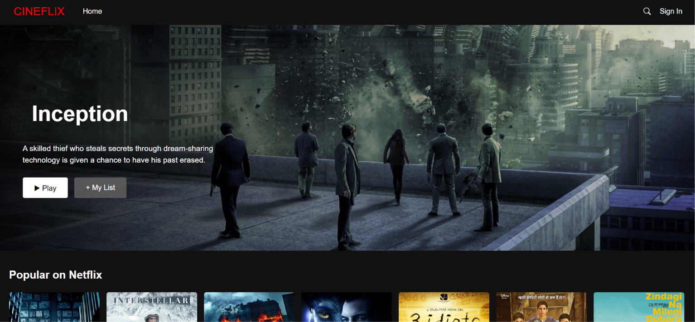
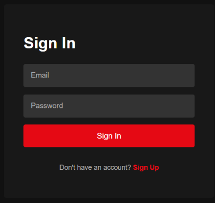
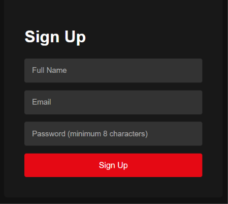
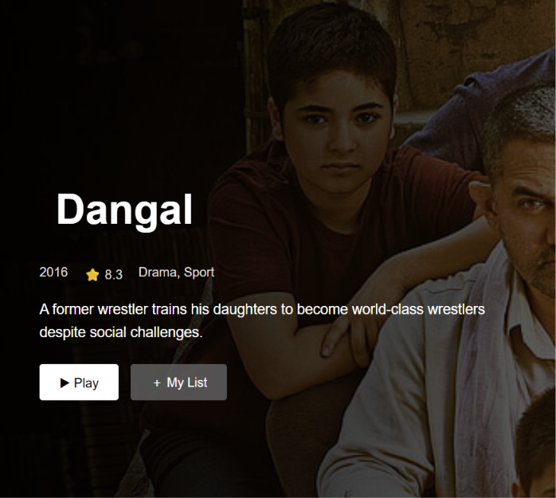
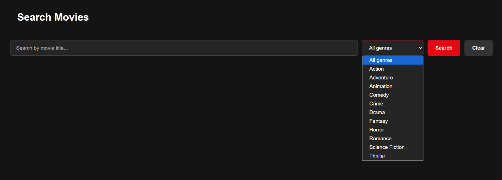

# Cineflix — Movie Streaming Platform

A full-stack movie streaming platform inspired by Netflix, built using **React, Node.js, Express, and MongoDB**.

Cineflix allows users to create an account, explore movies, search by title or genre, view movie details, watch trailers, and maintain a personal watchlist through a clean, Netflix-inspired interface.

---

## Features

### Authentication

- User registration and login.
- Secure password hashing using bcrypt.
- JWT-based authentication.
- Protected routes for authenticated users.
- Logout functionality.

### Movie Browsing

- Browse movies through a Netflix-inspired homepage.
- Movie cards with posters and details.
- Dedicated movie details page.
- Movie information including title, description, genre, language, release year, and rating.
- Watch movie trailers through links.

### Search and Discovery

- Search movies by title.
- Filter movies by genre.
- Backend-powered search functionality.

### Personal Watchlist

- Add movies to your personal watchlist.
- Remove movies from your watchlist.
- View saved movies in the My List section.

### User Interface

- Dark-themed Netflix-inspired design.
- Responsive movie browsing layout.
- Interactive buttons and hover effects.
- Hero section featuring selected movies.

---

## Tech Stack

| Category         | Technologies            |
| ---------------- | ----------------------- |
| Frontend         | React, Vite, JavaScript |
| Styling          | CSS                     |
| Routing          | React Router            |
| HTTP Requests    | Axios                   |
| Backend          | Node.js, Express.js     |
| Database         | MongoDB Atlas           |
| ODM              | Mongoose                |
| Authentication   | JWT, bcrypt             |
| API Architecture | REST API                |

---

## Getting Started

Follow these steps to run Cineflix locally.

### 1. Clone the repository

git clone https://github.com/amrita-0403/cineflix.git
cd cineflix

### 2. Set up the backend
cd backend
npm install

Create a .env file inside the `backend` directory and configure your environment variables.

PORT=8080
MONGO_URI=your_mongodb_connection_string
JWT_SECRET=your_secret_key

Replace the placeholder values with your own configuration.

Start the backend:

npm start

### 3. Set up the frontend

Open another terminal:

cd frontend
npm install
npm run dev

### 4. Open the application

Visit the local URL displayed by Vite, usually:

http://localhost:5173

---

### Screenshots

### Homepage

### Login Page

### Registration Page

### Movie Details

### Search

## Environment Variables

The backend requires environment variables for database connectivity and authentication.

| Variable     | Description                            |
| ------------ | -------------------------------------- |
| `PORT`       | Backend server port                    |
| `MONGO_URI`  | MongoDB connection string              |
| `JWT_SECRET` | Secret key used for JWT authentication |

---

## Database

Cineflix uses MongoDB to store movie and user information.

The application includes:

- **User collection:** Stores user details, hashed passwords, and watchlist references.
- **Movie collection:** Stores movie information such as title, description, poster, backdrop, genre, language, rating, and trailer URL.

Mongoose is used to define schemas and interact with the database.

---

## Application Workflow

1. A user registers or logs in.
2. The backend validates credentials and handles authentication.
3. A JWT token is issued after successful login.
4. The frontend uses the token for authenticated API requests.
5. Movie data is retrieved from MongoDB through REST APIs.
6. Users can search, filter, explore movie details, and manage their watchlist.

---

## Future Enhancements

- Personalized movie recommendations.
- Improved movie discovery and filtering.
- Enhanced user profile management.
- Better mobile and tablet experience.
- Deployment and production optimization.

---

## Author

**Amrita Patnaik**

- GitHub: [@amrita-0403](https://github.com/amrita-0403)
- Project: [Cineflix](https://github.com/amrita-0403/cineflix)

---

